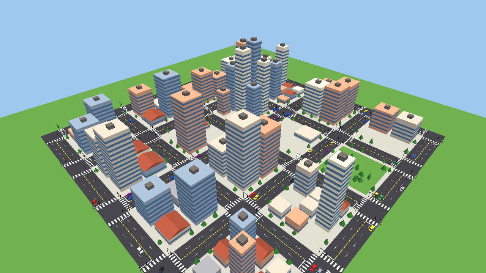

# Simulación multiagente de tráfico (Python + OpenGL)

Ciudad en 3D donde carros y semáforos son agentes. La meta es que los carros **aprendan con no-regret learning**
a partir de malas experiencias (choques, calles cerradas, mala velocidad). El plan completo está en
[`docs/plan.md`](docs/plan.md).



## Estructura del proyecto
```
carros_opengl/
├── visor.py              ← PROGRAMA PRINCIPAL: dibuja la ciudad y corre la simulación
├── trafico/              ← "cerebro": lógica de la simulación, SIN OpenGL
│   └── aprendizaje.py        algoritmos no-regret: Hedge, FixedShare, EXP3
├── experimentos/         ← pruebas sueltas para entender cada idea
│   └── paso0_rutas.py        juguete: 100 conductores, 2 rutas, una calle que se cierra
├── modelos/              ← modelos 3D (.obj + .mtl): ciudad, carro, llanta, semáforo
├── datos/                ← red_vial.json (el grafo de la ciudad)
├── herramientas/         ← scripts de apoyo
│   ├── generar_ciudad.py     genera modelos/ y datos/ (otra ciudad con otra semilla)
│   └── visor_obj.py          visor de un solo modelo (para revisar el carro, etc.)
└── docs/                 ← plan, guion del video, imágenes
```
**Regla de oro:** todo lo que *piensa* va en `trafico/` (sin OpenGL), todo lo que *dibuja* va en `visor.py`.
Así podemos entrenar muchos "días" rápido sin ventana y después solo visualizar.

## Instalar y correr
Todos los comandos se corren desde la carpeta del proyecto (aunque también funcionan desde otra).
```
pip install -r requirements.txt
python visor.py --carros 80                  # la ciudad
python experimentos/paso0_rutas.py           # demo de aprendizaje (solo texto)
python herramientas/visor_obj.py             # ver el carro solo
python herramientas/generar_ciudad.py 12     # regenerar la ciudad con la semilla 12
```
Controles del visor: flechas = orbitar, W/S = zoom, ESPACIO = pausa, ESC = salir.
Opciones útiles: `--foco=-60,0,-60` (punto al que mira la cámara), `--camara 30,30,60` (giro, elevación, distancia),
`--captura imagen.png --segundos 10` (guarda una imagen y sale).

## Convenciones
**Y hacia arriba**, unidades en **metros**, solo triángulos, normales por cara (`f v//vn`). Circulación por la derecha.
Una **pérdida** (lo que castiga a un agente) siempre va de 0 (perfecto) a 1 (lo peor).

## Modelos (`modelos/`)
| Archivo | Qué es |
|---|---|
| `ciudad.obj` | Escenario estático: grid de 5×5 intersecciones, calles de 2 carriles por sentido, banquetas, pasos de cebra, líneas de alto, glorieta central, edificios, casas, parques y árboles |
| `carro.obj` | Agente vehículo. Centrado en el origen, mira hacia **+Z**. Material `carroceria` separado para pintar cada auto de distinto color |
| `llanta.obj` | Llanta individual centrada en el origen, para girarla por separado |
| `semaforo.obj` | Agente semáforo. Base en el origen, luces mirando a **+Z**. Grupos separados: `luz_roja`, `luz_amarilla`, `luz_verde` |

Cada agente se dibuja instanciando el mismo modelo con distinta matriz:
```python
glPushMatrix()
glTranslatef(x, y, z)          # posición del agente
glRotatef(yaw, 0, 1, 0)        # yaw = degrees(atan2(dir_x, dir_z))
glCallList(lista_carro)
glPopMatrix()
```

## El grafo (`datos/red_vial.json`)
- `nodos`: 25 intersecciones (`id` "i_j", `pos`, `tipo` = `semaforo` | `glorieta`)
- `aristas`: 80 tramos **dirigidos** entre intersecciones. Cada una tiene `direccion`, `longitud`, `vel_max` (m/s)
  y 2 `carriles` (0 = izquierdo/interior, 1 = derecho/exterior) con puntos `inicio` → `fin`. El `fin` coincide con la línea de alto.
- `semaforos`: 76, con posición y `yaw_grados` listos para `glTranslatef`/`glRotatef`, la arista que controlan y su
  `grupo_fase` (`x` o `z`): los del mismo grupo en una intersección se ponen en verde juntos.
- `glorieta`: centro, radios de los carriles y sentido de giro.

## Comportamiento actual (versión inicial, sin aprendizaje)
- **Semáforo**: verde 12 s / amarillo 3 s / todo rojo 1.5 s, alternando eje X y eje Z, con desfase entre intersecciones (onda verde).
- **Carro**: Intelligent Driver Model (sigue al de enfrente con distancia de seguridad), se detiene en rojo/amarillo,
  cambia de carril si el de enfrente va lento, curvas Bézier dentro del cruce, glorieta en sentido antihorario.
  **Elige su siguiente calle al azar**: todavía no tiene destino ni aprende.
